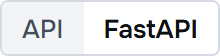
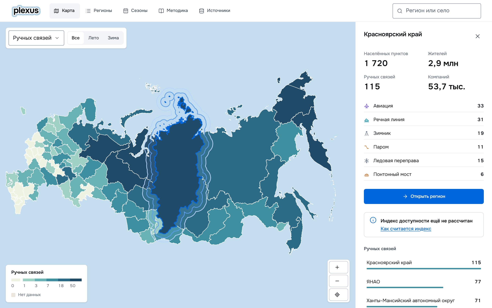
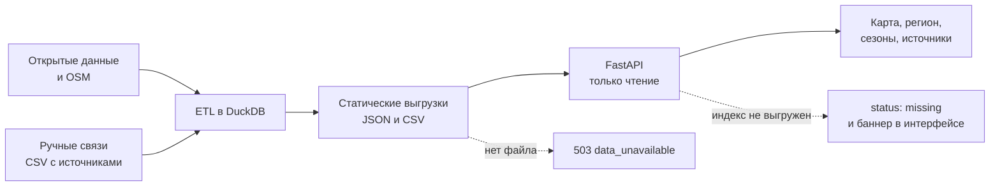
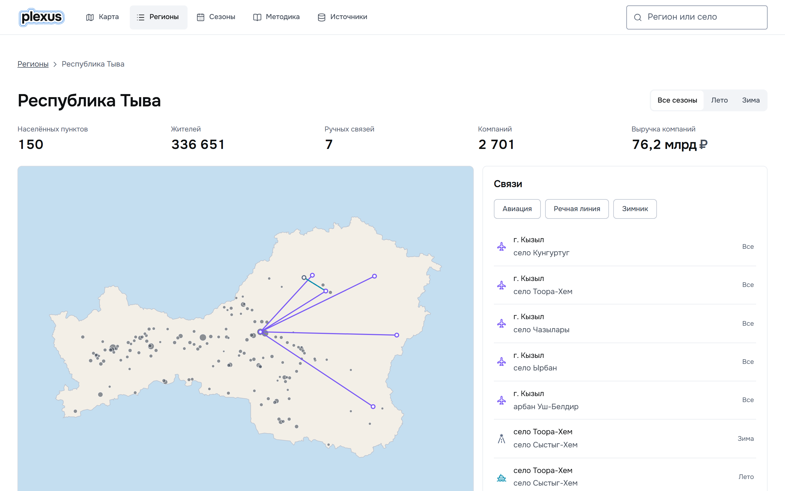

<p align="center">
<!-- readme:banner -->
<picture><source media="(prefers-color-scheme: dark)" srcset="docs/readme/banner.dark.png"></picture>
<!-- /readme:banner -->
</p>

<p align="center">Аналитик региональной политики открывает регион и видит, какие сёла связаны с остальной страной только самолётом, зимником или переправой, как часто туда ходит транспорт и откуда это известно.</p>

<p align="center">
<!-- readme:buttons -->
<a href="#запуск"><picture><source media="(prefers-color-scheme: dark)" srcset="docs/readme/button-run.dark.png"></picture></a>
<a href="docs/README.md"><picture><source media="(prefers-color-scheme: dark)" srcset="docs/readme/button-docs.dark.png"></picture></a>
<!-- /readme:buttons -->
</p>

<p align="center">
<!-- readme:status -->
<a href="#результаты"><picture><source media="(prefers-color-scheme: dark)" srcset="docs/readme/status-settlements.dark.png"></picture></a>
<a href="#результаты"><picture><source media="(prefers-color-scheme: dark)" srcset="docs/readme/status-links.dark.png"></picture></a>
<a href="#результаты"><picture><source media="(prefers-color-scheme: dark)" srcset="docs/readme/status-regions.dark.png"></picture></a>
<br>
<a href="#запуск"><picture><source media="(prefers-color-scheme: dark)" srcset="docs/readme/status-tests.dark.png"></picture></a>
<a href="#запуск"><picture><source media="(prefers-color-scheme: dark)" srcset="docs/readme/status-offline.dark.png"></picture></a>
<picture><source media="(prefers-color-scheme: dark)" srcset="docs/readme/status-locale.dark.png"></picture>
<!-- /readme:status -->
</p>

<p align="center">
<!-- readme:stack -->
<picture><source media="(prefers-color-scheme: dark)" srcset="docs/readme/stack-frontend.dark.png"></picture>
<picture><source media="(prefers-color-scheme: dark)" srcset="docs/readme/stack-types.dark.png"></picture>
<picture><source media="(prefers-color-scheme: dark)" srcset="docs/readme/stack-api.dark.png"></picture>
<br>
<picture><source media="(prefers-color-scheme: dark)" srcset="docs/readme/stack-data.dark.png"></picture>
<picture><source media="(prefers-color-scheme: dark)" srcset="docs/readme/stack-tools.dark.png"></picture>
<!-- /readme:stack -->
</p>

<p align="center">
<!-- readme:nav -->
<a href="#зачем-это"><picture><source media="(prefers-color-scheme: dark)" srcset="docs/readme/nav-why.dark.png"></picture></a>
<a href="#как-это-работает"><picture><source media="(prefers-color-scheme: dark)" srcset="docs/readme/nav-how.dark.png"></picture></a>
<a href="#попробовать-за-две-минуты"><picture><source media="(prefers-color-scheme: dark)" srcset="docs/readme/nav-try.dark.png"></picture></a>
<a href="#результаты"><picture><source media="(prefers-color-scheme: dark)" srcset="docs/readme/nav-results.dark.png"></picture></a>
<a href="#запуск"><picture><source media="(prefers-color-scheme: dark)" srcset="docs/readme/nav-run.dark.png"></picture></a>
<a href="#устройство"><picture><source media="(prefers-color-scheme: dark)" srcset="docs/readme/nav-layout.dark.png"></picture></a>
<br>
<a href="#ограничения"><picture><source media="(prefers-color-scheme: dark)" srcset="docs/readme/nav-limits.dark.png"></picture></a>
<!-- /readme:nav -->
</p>

<p align="center">

<br>
<sub>Локальный запуск, 8 ноября 2026 года: карта по числу ручных связей во все сезоны, выбран Красноярский край (115 связей).</sub>
</p>

> **Неизвестное не превращается в ноль.** Если у населённого пункта нет данных о компаниях, API отдаёт `null`, а интерфейс пишет «нет данных». Пока расчёт индекса не выгружен, `GET /api/v1/index` отвечает `status: missing`, и карта показывает исходные связи с пометкой «Расчёт не подключён», а не пустую шкалу индекса.

## Зачем это

Дорожный граф не знает, что в село Кунгуртуг в Тыве из Кызыла летают Ми-8 и Ан-2 два раза в неделю и что [рейсы приостанавливали при нехватке субсидий](https://www.tuvaonline.ru/2025/03/11/v-tuve-v-otdalennoe-i-trudnodostupnoe-selo-kurgurtug-samolety-budut-letat-dvazhdy-v-nedelyu.html). На такой карте село выглядит либо отрезанным, либо связанным дорогой, по которой не проехать круглый год. Таких связей в атласе 997 в 82 регионах: 480 авиарейсов, 266 речных линий, 77 зимников, 75 паромов, 71 ледовая переправа и 28 понтонных мостов (`GET /api/v1/overview`).

Plexus собирает эти связи с источником, сезоном и частотой и кладёт их рядом с дорогами. На том же примере регион Тыва показывает семь связей, Кызыл как узел пяти авиалиний и сезонные пары, например зимник Тоора-Хем – Сыстыг-Хем, который летом заменяет речная линия.

Название от латинского plexus, «сплетение»: так анатомы называют узел, где сходятся нервы или сосуды. Три кольца знака повторяют изохроны, линии равного времени в пути.

## Как это работает



| Индекс доступности | Сезоны связей | Шкала карты |
| --- | --- | --- |
| Индекс Хансена: сумма 180 рынков, вес каждого падает вдвое за 2 часа пути по дорогам, магистралям и ручным связям. | Режим «Все» считает и связи без сезона, «Лето» и «Зима» добавляют к сезонным круглогодичные, поэтому авиарейс не пропадает летом. | Классы строятся естественными разрывами по логарифму значений, каждый порог округлён до самого круглого числа между классами, ноль идёт отдельным цветом. |
| Проверка: скорости откалиброваны по 24 тыс. пар матрицы «Если быть точным», r = 0,993 ([допущения модели](docs/data-pipeline.md#допущения-модели)). | Проверка: `backend/tests/unit/domain/test_transport.py`. | Проверка: `frontend/tests/features/map-explorer/scale.test.ts`. |

## Попробовать за две минуты

Запустите бэкенд и фронтенд по разделу [«Запуск»](#запуск) и откройте http://127.0.0.1:5173.

| Что сделать | Что увидите |
| --- | --- |
| В поиске наберите «тыв» и выберите Республику Тыва | Страница региона: семь связей на карте и в списке, у каждой источник и частота |
| Нажмите чип «Зимник» над списком связей | На карте и в списке остаётся одна связь, Тоора-Хем – Сыстыг-Хем |
| Откройте «Сезоны» | Полосы открытия и закрытия зимников Югры за зимы 2024/25 и 2025/26 |

<p align="center">

</p>

## Результаты

Покрытие атласа посчитано API по выгрузке в `frontend/atlas/public` на 8 ноября 2026 года.

| Метрика | Продукт | Как проверить |
| --- | --- | --- |
| Населённые пункты с координатами | 155 412 | `curl -s 127.0.0.1:8000/api/v1/overview` |
| Ручные связи | 997 в 82 регионах | Тот же ответ, поля `links` и `links_by_mode` |
| Связи с известным сезоном | 930 из 997 | `links_by_season`: 67 записей без сезона |
| Время по дорогам против матрицы «Если быть точным» | r = 0,993, в среднем на 6,6 % дольше, 24 тыс. пар | [Допущения модели](docs/data-pipeline.md#допущения-модели) |

**Где проигрываем.** Расчёт индекса Хансена описан в пайплайне (`etl/indices.py`), но его значения в интерфейс не выгружены: `indices.json` пуст, поэтому карта раскрашена по исходным показателям. Частота рейса известна не везде: где её нет, принят один рейс в неделю, и интерфейс это помечает.

<details>
<summary>Как воспроизвести расчёт</summary>

Полный пайплайн скачивает около 4 ГБ OSM и держит граф России в памяти (пик около 6 ГБ). Команды и время шагов описаны в [docs/data-pipeline.md](docs/data-pipeline.md#основной-расчётный-пайплайн).

</details>

## Запуск

Нужны [uv](https://docs.astral.sh/uv/) и Node.js 22. Данные атласа лежат в репозитории, ключи и сеть не нужны. Команды запускаются из корня репозитория в двух терминалах.

```bash
cd backend && uv sync && uv run uvicorn app.main:create_app --factory --port 8000
```

```bash
cd frontend && npm ci --silent && npm run dev
```

Интерфейс: http://127.0.0.1:5173. API и его схема: http://127.0.0.1:8000/docs.

<details>
<summary>Проверки и переменные</summary>

```bash
cd frontend && npm run verify
cd backend && uv run ruff check . && uv run mypy . && uv run pytest tests/unit
```

`npm run verify` запускает 36 правил дизайн-системы, проверку типов, линтер, 333 теста и сборку. Бэкенд проверяют 103 модульных теста.

| Переменная | По умолчанию | Назначение |
| --- | --- | --- |
| `DATA_DIR` | `frontend/atlas/public` | Каталог выгрузки атласа для API |
| `API_URL` | `http://localhost:8000` | Куда фронтенд проксирует `/api` в режиме разработки |

Картинки этого README рисуются из токенов и знака продукта: `cd frontend && npm run readme`, снимки экранов `npm run readme:hero` при запущенном интерфейсе.

</details>

## Устройство

Бэкенд на FastAPI построен по слоям domain, usecase, repository и controller и только читает выгрузку атласа. Фронтенд на React разбит по FSD: сущности региона, связи и населённого пункта, фичи карты и таблиц, страницы.

| Документ | О чём |
| --- | --- |
| [docs/data-pipeline.md](docs/data-pipeline.md) | ETL, сбор ручных связей, допущения модели |
| [docs/indices.md](docs/indices.md) | Индексы из исследований, которые считает пайплайн |
| [docs/data-audit-2026-11-07.md](docs/data-audit-2026-11-07.md) | Какие источники получены и что из них можно построить |
| [docs/brand/](docs/brand/) | Знак Plexus в светлом и тёмном вариантах |

## Ограничения

- **Индекс не выгружен в интерфейс.** Формула и параметры зафиксированы, значений по регионам в выгрузке нет; до тех пор карта показывает исходные данные.
- **Ручные связи собраны неравномерно.** 67 из 997 связей без сезона, частота части рейсов принята за один в неделю, история сезонов есть только для зимников Югры (18 записей).
- **Подложка регионов 2013 года.** Контур Крыма дополнен из geoBoundaries / OpenStreetMap за 2017 год; линия 180-го меридиана видна на Чукотке.

<p align="center">
<!-- readme:footer -->
<picture><source media="(prefers-color-scheme: dark)" srcset="docs/readme/footer.dark.png"></picture>
<!-- /readme:footer -->
<br>
<sub>Направление «Транспорт и территории», задача «Индекс транспортной связанности», 2026.</sub>
</p>
