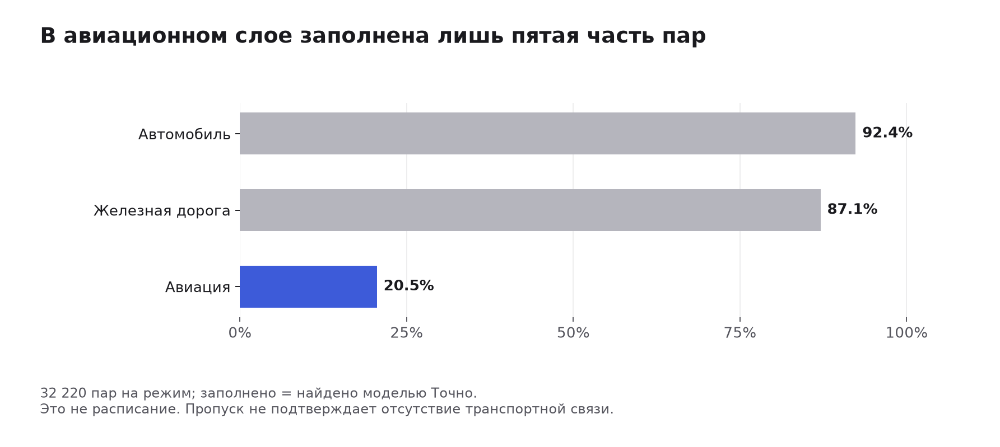
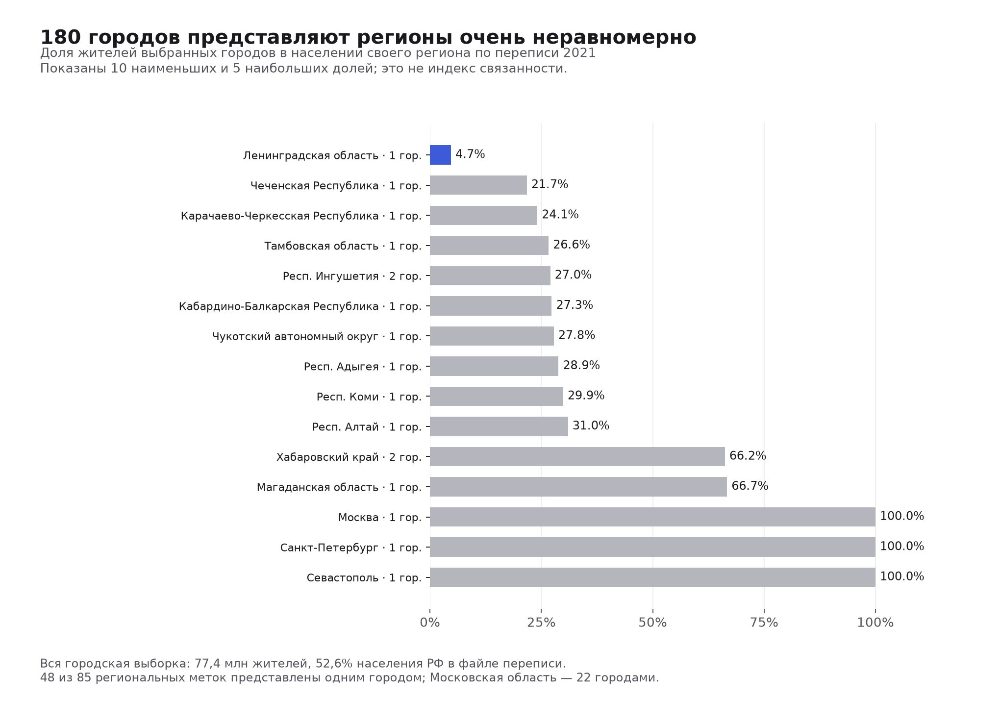
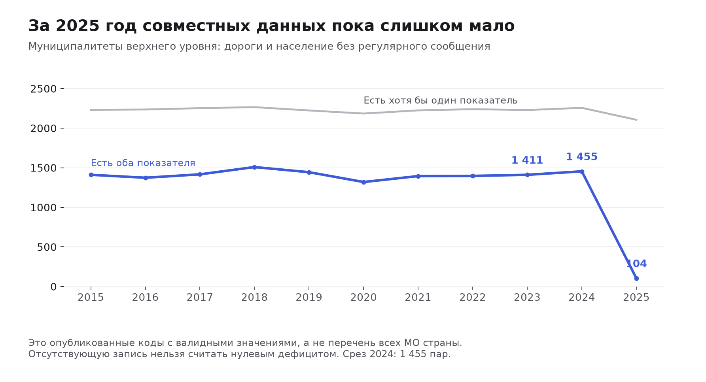

> Историческое исследование 6–7 ноября 2026. Гипотезы и предварительные числа ниже не являются результатами текущего пилота или национального пересчёта. Действующая методика: [документация](../../README.md).

# Что данные позволяют построить и посчитать

Разведка выполнена по скачанным файлам, а не только по описаниям источников. Наиболее готовая основа для расчётного инструмента — таблица поездок между 180 городами. Второй содержательный вариант — муниципальные дефициты регулярного сообщения на ограниченной территории. Региональные агрегаты дают контекст; близость к аэропортам уже посчитана как отдельный геометрический показатель. Окончательная цель и масштаб проекта пока не выбраны.

## Какие масштабы действительно поддерживаются

| Ветка | Единица сравнения и период | Что рассчитано | Готовность к инструменту |
|---|---|---|---|
| Межгородская доступность | 180 выбранных городов; маршруты 2026, население 2021 | Доступные цели за 6/12/24 часа, взвешенный населением потенциал, полнота, чувствительность, условное изменение времени | Можно собрать калькулятор на имеющихся данных, явно показывая модель времени и неизвестные направления |
| Муниципальные дефициты | 1 455 МО верхнего уровня в 84 регионах, совместный срез 2024 | Два показателя дефицита, сопоставимые когорты, изменения 2023–2024, варианты пилотных регионов | Можно сравнивать опубликованные проблемные территории; для конкретных изменений сообщения нужны маршруты и население того же периода |
| Региональный транспортный профиль | 85 неперекрывающихся региональных объектов, 2023; ж/д — 78 | Автобусные пассажиро-км и перевозки на жителя, средняя длина зарегистрированной поездки, контекст ВРП и инфраструктуры | Готов к описательному сравнению; интенсивность транспортной работы не равна доступности поездки |
| Близость к аэропортам | 155 747 НП и 157 объектов с флагом регулярного обслуживания | Расстояние по большой окружности, доли населения в радиусах, взвешенные квантили и региональные разрезы | Готов как геометрический ориентир; реальное время подвоза и работа рейсов неизвестны |
| Порты и бассейны | 42 портовые карточки, 25 национальных лет и отдельные бассейновые периоды | Мощности и инфраструктура, национальная динамика, аудит единиц и версий | Не хватает индивидуального грузооборота и связей подвоза для оценки загрузки конкретных портов и перераспределения потоков |

## Межгородской калькулятор уже можно проверить на числах

Проверены все 96 660 записей «город отправления × город назначения × режим». Они уникальны, самоссылок нет, атрибуты городов согласованы. В каждом режиме 32 220 направленных пар. Из них заполнено: авто — 29 756 (92,4%), ж/д — 28 056 (87,1%), авиа — 6 618 (20,5%).



Время источник уже получил из расстояний и предположений: авто — км/75 + 0,5 часа, ж/д — км/55. Авиа имеет свои правила, но подвоз к аэропорту и ожидание рейса не входят. Поэтому основной пробный расчёт использует авто и минимум авто/ж/д для каждой пары, без моделирования пересадок. Симметрия матриц следует копированию обратного маршрута в методологии, а не подтверждает одинаковые реальные расписания.

Для каждого города уже есть:

- число других выбранных городов и доля населения целей в пределах 6, 12 и 24 часов;
- потенциал `A_i(tau) = sum(pop_j * exp(-time_ij / tau)) / sum(pop_j)`, с исключением собственного города, при tau = 6/12/24 часа;
- доля известных направлений и населения целей; условные нижняя/верхняя оценки вклада неизвестных направлений;
- чувствительность к режиму, временному параметру и множеству целей.

Это исследовательская формула, не утверждённый индекс команды. Население — прокси размера цели, не число рабочих мест, пациентов или реальный грузовой спрос. Неизвестный маршрут не объявляется отсутствующим: нулевой вклад даёт только условную нижнюю оценку при принятой модели известных времён. Для шести городов в минимуме авто/ж/д неизвестны все направления; они не получают доказанное последнее место по реальной связанности.

**Проверенный условный сценарий:** уменьшение автооценки Кострома — Обнинск на 20%, с 6,6 до 5,28 часа, увеличивает число направлений до 6 часов с 32 до 33 у каждого города. Потенциал tau=12 изменяется у Костромы с 0,330314 до 0,330423, у Обнинска с 0,372276 до 0,372509. Изменены только две исходные ячейки. Это проверка пересчёта, не доказательство эффекта строительства, его стоимости или реализуемости. Проверена монотонность всех рассчитанных мер.

Перебор параметров показывает общую устойчивость рангов: tau=6 против tau=24 даёт Spearman около 0,988, но отдельные места сдвигаются до 26 позиций. Выбор центров/целей вне своего административного региона даёт корреляции 0,9976–0,9984 и сдвиги до 15 мест. Из этого нельзя выбрать правильную цель автоматически. Исходный флаг центра установлен у 84 городов: у Московской области отмеченного центра нет.

Верхние значения потенциала часто у Подмосковья из-за близкой Москвы как большой внешней цели. Собственные внутригородские возможности не учитываются. Такой результат описывает межгородское определение доступности, а не качество жизни или превосходство пригородов над Москвой. Исключение своего административного региона не устраняет Московскую агломерацию.

**Границы модели:** 2,67% сравнимых автомобильных троек нарушают треугольную согласованность более чем на 0,15 часа. Например, Люберцы — Уссурийск: 125,2 часа против суммы исходных OD-оценок через Красноярск 110,1 часа. Исходные пары не являются проверенной физической сетью кратчайших путей. Автоматическая прокладка новых рёбер или замена всех времён кратчайшими путями потребовала бы отдельной модели и проверки.

Подробности: [исследование графа](graph/findings.md), [все оценки](graph/results/accessibility.csv), [сценарий](graph/results/hypothetical_scenario.csv), [чувствительность к целям](graph-extra/findings.md).

## 180 городов не представляют одинаковую долю каждого региона

Их население — 77 396 548 человек, или 52,59% населения РФ в той же переписной базе. Из 85 региональных меток 48 представлены одним городом, Московская область — 22. Для Ленинградской области выбранный город представляет 4,72% населения региона. Три федеральных города в справочнике, напротив, представлены целиком как административные объекты.



Для проверки использовано 177 точных совпадений городского ОКТМО; три федеральных города сопоставлены по точному имени и уровню из-за различной длины кода. Население согласуется для всех 180 городов. Региональные имена совпали точно. Префиксное или нечёткое объединение не применялось.

**Вывод для масштаба:** по этой таблице обоснованно сравнивать выбранные города и их цели. Среднее по доступным городам нельзя представлять как связанность всех жителей региона.

Проверка и таблицы: [представленность](representativeness.json), [регионы](region_sample_coverage.csv), [сопоставление городов](city_census_join.csv), [скрипт](representativeness.py).

## Муниципальный вариант содержателен, но публикация ограничивает охват

Есть два разных показателя: доля ненормативных местных дорог и доля населения без регулярного автобусного и/или железнодорожного сообщения с административным центром. Второй прямо относится к цели доступа в административный центр. Наличие регулярного сообщения не описывает время, частоту, цену или доступ к конкретной больнице.

| Год | МО верхнего уровня с хотя бы одним валидным показателем | С обоими | Доля пар внутри этого наблюдаемого объединения |
|---|---:|---:|---:|
| 2023 | 2 229 | 1 411 | 63,3% |
| 2024 | 2 257 | 1 455 | 64,5% |
| 2025 | 2 106 | 104 | 4,9% |



Это не полнота по официальному списку всех МО страны. На нижнем уровне в 2024 есть 4 806 дорожных наблюдений и ни одного наблюдения второго показателя: переносить районные значения на поселения нельзя.

Проверена [первичная методология Точно](https://storage.yandexcloud.net/tochno-st-catalog/Rosstat/data_bdmo_118_v20260928/description_bdmo_112_v20260928.pdf), физическая страница 13: отсутствие строки может означать отсутствие явления или отсутствие данных; различить их по публикации нельзя. Нули в исходниках существуют, но в целевых показателях среза 2024 их нет. Поэтому исключённые территории нельзя автоматически объявлять благополучными. [Локальная копия методологии](territories/description_bdmo_112_v20260928.pdf) и [контрольная сумма](territories/municipal-methodology-source.json) сохранены.

Найдены 139 строк в 35 неоднозначных ключах; они исключены без усреднения. Дорожное значение 651% за 2020 отмечено аномальным источником и исключено. Уточняющие измерения, уровни, годы и единицы не смешивались. В парной когорте 2024 медианы: ненормативные дороги — 49,8%, население без сообщения — 2,33%; это не средние оценки всей страны.

**Что можно сделать:** сравнение двух дефицитов и Парето-приоритетов без произвольного общего веса; базовый индекс доступа `100 - доля без регулярного сообщения`; динамика в процентных пунктах на неизменных кодах. Сбалансированная когорта 2023–2024 содержит 1 328 МО в 81 регионе. Причину улучшения или эффект ремонта из этого вывести нельзя.

Для локального пилота есть вариация и хорошее совместное наблюдаемое покрытие, например: Смоленская область — 26/27, Новгородская — 21/22, Томская — 18/19, Якутия — 33/35. Это кандидаты для проверки, а не уже выбранная география.

Население переписи точно присоединилось по полному ОКТМО к 1 255 из 1 455 МО. Оно относится к 2021, а доля — к 2024; границы могли измениться. Умножение не даст точного числа жителей без сообщения в 2024. Для сценария конкретного маршрута нужны обслуживаемые населённые пункты, актуальное население и параметры движения.

Подробности: [муниципальная и региональная разведка](territories/findings.md), [пары 2024](territories/municipal-upper-paired-2024.csv), [кандидаты регионов](territories/municipal-region-options-2024.csv), [динамика](territories/municipal-balanced-changes-2023-2024.csv).

## Региональные показатели пригодны как контекст и самостоятельный описательный срез

После исключения двух вложенных агрегатов областей с автономными округами за 2023 доступны 85 сопоставимых объектов для автобусных показателей, ВРП и населения; для ж/д — 78. Коды ОКТМО сами по себе недостаточны: область с округом и без него могут иметь одинаковый код. Числовые служебные пропуски исключены до деления и ранжирования.

Рассчитаны пассажиро-км на жителя, число зарегистрированных автобусных перевозок на жителя и средняя длина поездки как отношение пассажирооборота к пассажирам. Повторные поездки одного человека считаются повторно; это не число уникальных пользователей. ВРП и население заканчиваются 2023; показатели 2024 не выдаются за один синхронный срез с ними.

В полной региональной подборке 40 CSV и 1 201 различное название показателя; есть занятость, медицина, инвестиции, доходы, дорожная обеспеченность. Пересечения разделов не являются независимыми наблюдениями. Региональное число коек или вакансий не сообщает координаты больниц и рабочих мест, поэтому не заменяет данные назначений для конкретной поездки.

Результаты: [автобусные интенсивности](territories/regional-bus-intensities-2023.csv), [покрытие региональных соединений](territories/regional-join-cohorts.csv), [каталог названий показателей](available_indicators.csv). Годы в последнем относятся ко всей таблице, не гарантируют наличие каждого показателя в каждом году.

## Расстояния до аэропортов уже посчитаны, их смысл ограничен геометрией

Все 155 747 строк НП имеют корректные числовые координаты. Для каждого найден ближайший из 157 объектов с флагом scheduled_service=yes. В населении именно этого слоя доля не далее 50/100/200 км составляет 51,02% / 68,93% / 88,29%. Взвешенная медиана — 46,82 км, p90 — 215,05 км. Это расстояния по большой окружности до выбранного справочника, не дорога или время доступа.

Сумма населения слоя — 128 796 185; она не является населением всей РФ. Федеральные города рассчитаны отдельно: прибавление их полного населения к подчинённым НП дало бы двойной счёт. В региональном справочнике 85 строк, но НП есть в 84 регионах; для Санкт-Петербурга геометрические показатели слоя НП отсутствуют. Выявлено расхождение суммы НП и строки региона у Архангельской области на 31 008 человек, которое не исправлялось догадкой.

Можно сравнивать удалённость, выделять территории для проверки подвоза и проверять справочник. Для реальной авиационной связанности нужны направления, работа рейсов, частота, тарифы и наземный подвоз. Даже удалённость от выбранного аэропорта не доказывает отсутствие местного аэродрома: регулярный флаг неполон.

Подробности: [расчёт](air-distance/findings.md), [регионы](air-distance/distance_by_native_region.csv), [результаты и проверки](air-distance/results.json).

## Портовый сценарий требует дополнительных входов

Мощность распознана для 41 из 42 портов; 39 проходят проверку явной годовой единицы без выявленных предупреждений. Общего года измерения нет. Число причалов и длину фронта можно описывать, но специализации грузов и единицы различаются. Для фактической загрузки каждого порта нет индивидуального годового грузооборота.

Из одного графика АСОП восстановлены 25 национальных годовых наблюдений 2000–2024; контроль опубликованных процентов использования даёт расхождение менее 0,05 п.п. Но это один объект «Россия». Бассейновые PDF в основном сканы. В опубликованных источниках есть конфликтующие версии; за 2023 сумма бассейнов 883,8 млн т расходится с национальным графиком 906,9 млн т. Подпись национального графика проверена визуально; расхождение не устранялось заменой значения.

Без связей «территория → порт», потоков по портам, ограничений подвоза и стоимости нельзя обоснованно оптимизировать перераспределение грузов или считать эффект разгрузки конкретного порта. Полученные файлы пригодны для инфраструктурного справочника и контекста.

Подробности: [портовая разведка](ports/findings.md), [извлечённые мощности](ports/port_capacity_panel.csv), [аудит согласованности](ports/asop_annual_total_consistency.csv).

## Как выбирать направление после разведки

**Наша рекомендация:** первым кандидатом рассмотреть инструмент межгородской доступности выбранных городов. У него уже есть входы, прозрачные формулы и проверенный пересчёт вариантов. Утвердить нужно цель поездки/доставки, набор целей и трактовку неизвестных направлений. Изменение OD-времени остаётся допущением сценария до независимого подтверждения транспортного изменения.

Если команде важнее регулярное сообщение небольших территорий, сильнее содержательно локальный муниципальный пилот. Тогда сначала проверить публикацию и реальные маршруты в одном из регионов с хорошей совместной выборкой. Формула `100 - доля без сообщения` проста и объяснима; транспортный эффект требует данных о том, кого обслужит изменение. Геометрическая близость к аэропорту может быть дополнительным слоем, а региональные агрегаты — контекстом.

Доступ к больницам/рабочим местам, ожидание пересадок, сезонная надёжность, затраты и причинный эффект инфраструктуры пока не обеспечены нужными входами. Наличие региональных агрегатов не восполняет эти сведения.

## Как воспроизвести и что проверено

Результаты сохранены вместе со скриптами. Основные расчёты используют Python, numpy и pandas; портовые PDF требуют pdftotext. Графики используют matplotlib; зависимости не добавлялись в приложение. Материалы ИИ — код извлечения, вычисления и эти выводы; проверка включает чтение первичных методологий, контроль входных SHA-256, кодов пропуска, уровней и единиц, согласованность ключей, независимые контрольные пересчёты и просмотр рисунков. Разведка не заменяет внешнюю валидацию целевого индекса.

```bash
python3 work/eda/representativeness.py
python3 work/eda/graph/analyze_graph.py --input-root datasets/intercity_connectivity --out work/eda/graph/results
python3 work/eda/graph-extra/destination_sensitivity.py --input-root datasets/intercity_connectivity --out work/eda/graph-extra/results
python3 work/eda/ports/analyze.py --repo .
python3 work/eda/air-distance/analyze.py --repo .
python3 work/eda/validate.py
python3 work/eda/plot_findings.py
```

Команды муниципального анализа и необходимые входы приведены в [инструкции](territories/README.md). Окружение исходного расчёта графа сохранено в [environment.json](graph/environment.json). CSV и JSON показывают условные расчёты без изменения исходных файлов. Карта РФ не скачивалась.
