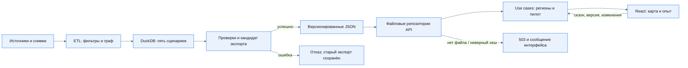

# Как проходит расчёт и где возможен отказ

> Тяжёлый национальный расчёт отделён от чтения готовых данных. Маленький пилот пересчитывается синхронно через настоящий API.

**Читайте, если** проверяете зависимости и воспроизводимость

---

## Какие части отвечают за результат?

Backend: `controller` проверяет запрос и преобразует ответ; `usecase` связывает сценарий с портом; `domain` считает ожидание и маршруты; `repository/files` читает экспорт. Композиция находится в `backend/src/app/main.py`. В приложении нет записи в DuckDB и нет миграций хранилища продукта.

Frontend: `app → pages → widgets → features → entities → shared`; API-типы генерируются из OpenAPI. TanStack Query хранит полученные данные, URL — сезон, режим и выбор региона. Форма пилота хранит изменения отдельно от последнего рассчитанного опыта.

## Почему национальный слой не пересчитывается в запросе?

Граф содержит миллионы узлов, поэтому пакетный расчёт выполняется отдельно. API читает 410 региональных строк и пилот из 19 рёбер. При смене экспортов процесс backend перезапускается, чтобы очистить файловый кэш. Контрольные суммы и версии возвращаются в результатах пилота и национальных строках.

## Где заканчивается архитектурная гарантия?

Независимый алгоритм проверяет арифметику на одном графе. Хеш фиксирует файл, но не истинность транспортного факта. Текущая проходимость, расписания и доступность перевозки проверяются внешними наблюдениями. [Ограничения](limitations.md).

---

[Оглавление документации](README.md) · [README проекта](../README.md)
