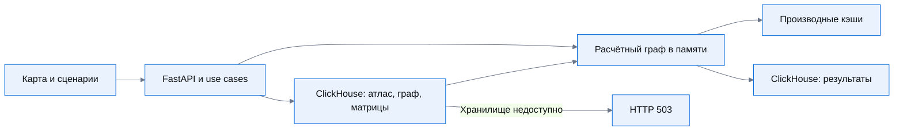

# Архитектура расчёта

React обращается к FastAPI через типизированный API. Карта, сравнение регионов, чат и
сценарии используют общую географию атласа. Контроллеры вызывают use cases через порты;
адаптеры выполняют маршрутизацию и взаимодействие с языковой моделью.

Атлас, индексы, матрицы времён, граф и история расчётов читаются из ClickHouse.
`GraphSnapshot` предоставляет адаптерам именованные выборки; SQL и Arrow остаются
в репозитории. `GRAPH_DIR` задаёт каталог производных численных кэшей.
Предрасчитанные расстояния до рынков сохраняются на диске и загружаются в память.
Одна новая связь обрабатывается через обновление расстояний; изменение существующих
дорог выполняется в фоновой очереди полного пересчёта. Источники остаются неизменными.

Чат, ручная форма и автоматический поиск улучшений вызывают одни расчётные use cases.
Результаты задач сохраняются и восстанавливаются после перезапуска.

У лаборатории `/scenarios` отдельный версионированный набор таблиц `plexus_scenario`.
При отсутствии нужных данных API возвращает 503; интерфейс показывает ошибку.
[Контракты](api.md), [запуск](running.md), [метод и ограничения](road-analysis.md).

Подготовленный слой дорог читается из ClickHouse через `RoadViewSource`; файлового
переключения при ошибке БД нет.
Расчётный граф остаётся отдельным от геометрии отображения. Схема перенесённых данных,
включение и ограничения: [аналитическое хранилище](clickhouse.md).

